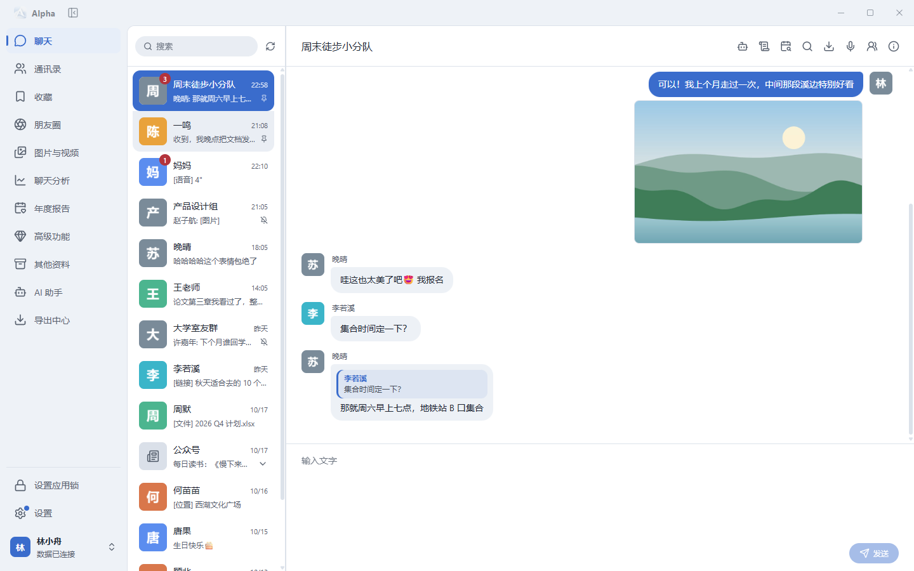
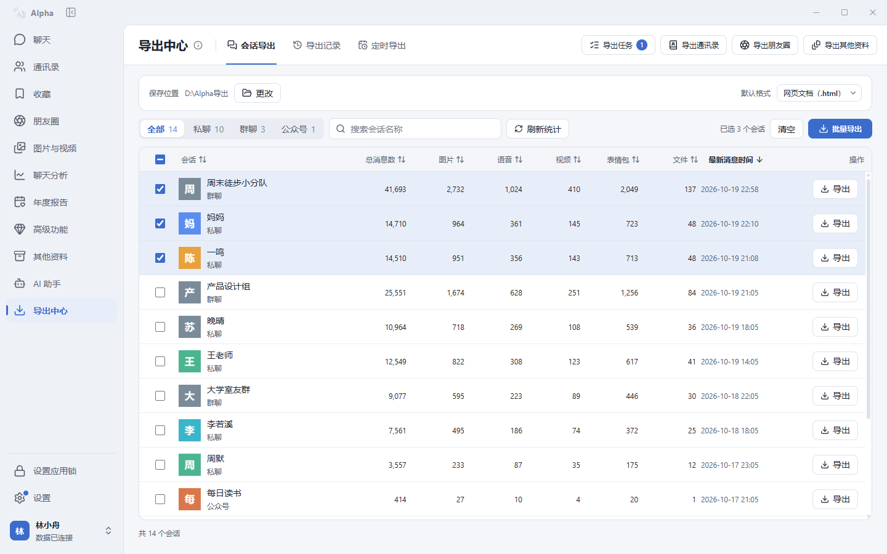
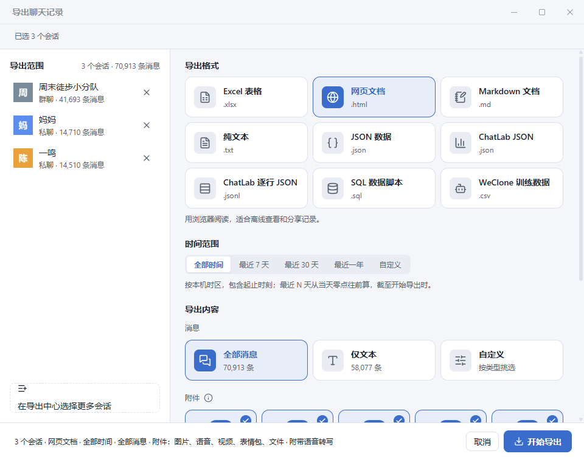
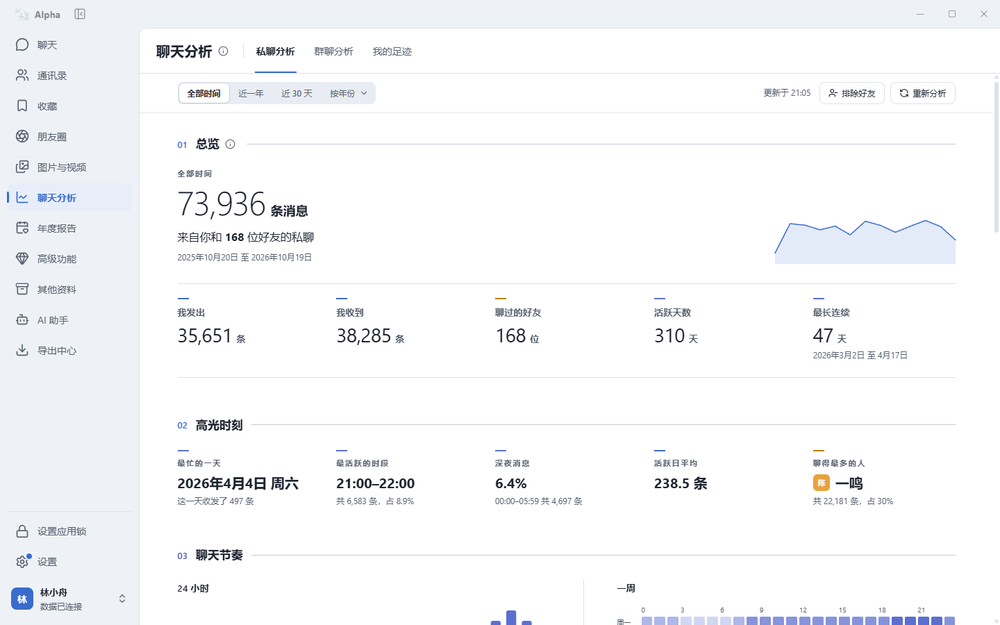
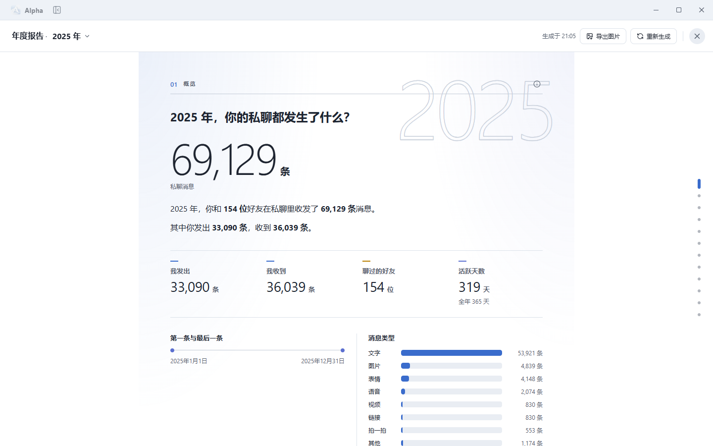
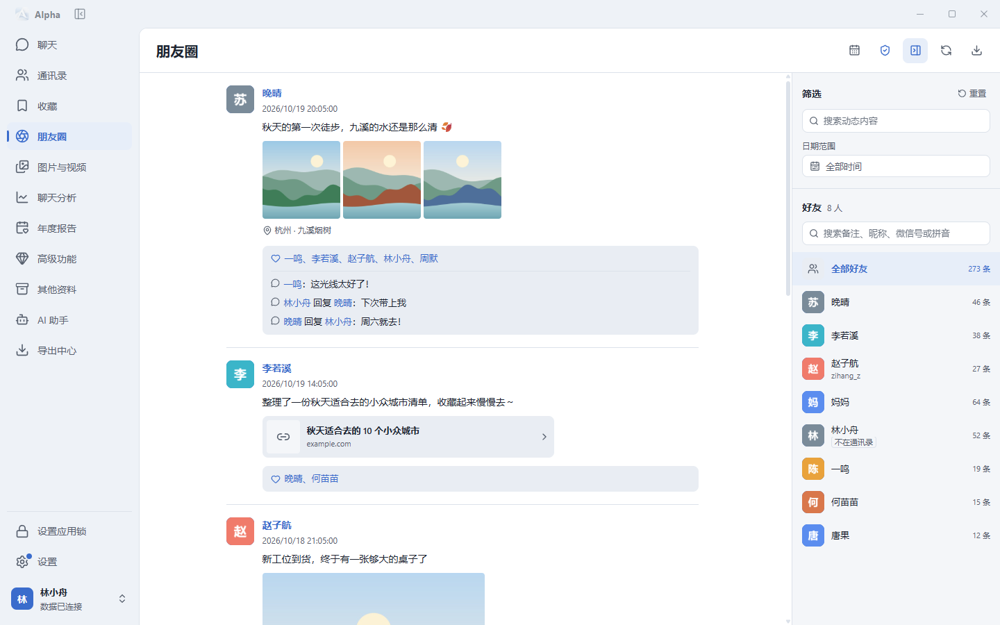
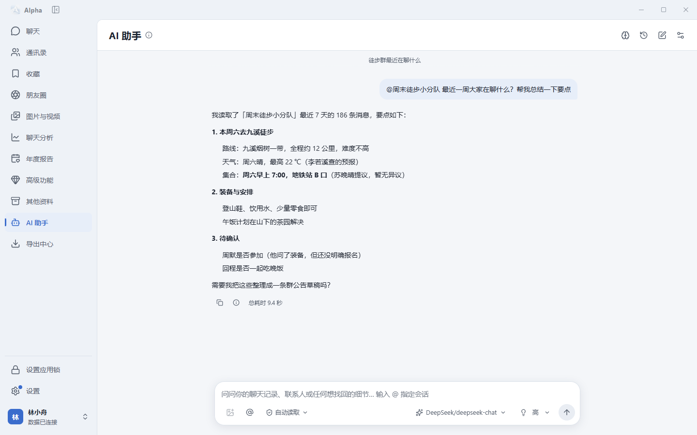
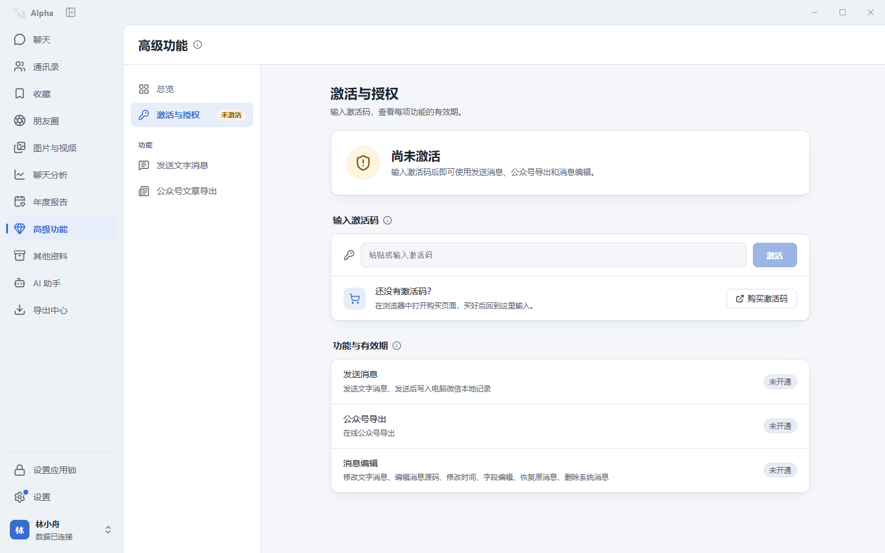

  

<h1 align="center">Alpha</h1>

  在电脑上查看、搜索、分析和导出你的<strong>微信聊天记录</strong>。 
  所有数据都在本机读取和处理，普通功能全部免费开放。

  
  
  

  

> [!TIP]
> **普通功能全部免费**：聊天记录浏览、搜索、导出、聊天分析、年度报告、朋友圈、AI 助手、防撤回、防删除等，不需要激活码。
>
> 只有 **发送消息、公众号文章导出、消息编辑** 三项高级功能需要激活码，👉 [购买激活码](https://catfk.com/shop/PIXGYA4H)。

> [!NOTE]
> 本页截图里的人物、头像、聊天内容和统计数字都是演示数据。

## 目录

- [主要功能](#主要功能)
- [聊天记录导出](#聊天记录导出)
- [聊天分析与年度报告](#聊天分析与年度报告)
- [朋友圈](#朋友圈)
- [AI 助手](#ai-助手)
- [全部免费功能](#全部免费功能)
- [高级功能](#高级功能)
- [下载与安装](#下载与安装)
- [开发者接口](#开发者接口)
- [隐私说明](#隐私说明)
- [社区](#社区)

## 主要功能

- **聊天记录**：像微信一样浏览私聊和群聊，图片、语音、视频、文件、链接、引用、聊天记录都能看；支持全局搜索、按日期跳转、查找图片/文件/链接。
- **聊天记录导出**：一次勾选多个会话，导出为 HTML、Excel、TXT、Markdown、JSON、ChatLab、SQL、WeClone 等格式，可带上图片、语音、视频、表情包和文件，也可以定时自动导出。
- **聊天分析**：私聊分析、群聊分析、我的足迹，看看你和谁聊得最多、几点最活跃、谁先开口、回复有多快。
- **年度报告 / 双人报告**：一键生成你和所有好友的年度报告，或者和某一位好友的专属报告，可导出图片分享。
- **朋友圈**：浏览、筛选、按日历查看好友的朋友圈，支持实况照片和视频；可导出朋友圈，并开启防删除。
- **AI 助手**：接入你自己的模型服务（DeepSeek、OpenAI、Claude、Gemini 等，也可用 ChatGPT 账号登录），直接问聊天记录里的问题。
- **数据保护**：消息防撤回、朋友圈防删除、应用锁。
- **开发者接口**：本机 HTTP API 与 MCP，可接入脚本、ChatLab、Claude Code、Cursor、Cherry Studio 等工具。

## 聊天记录导出

导出中心列出所有会话及各类消息的数量，勾选后可以批量导出，也可以在聊天页一键导出当前会话。

  

选择导出格式、时间范围、消息类型和要一起保存的附件：

  

| 格式 | 适合 |
|---|---|
| 网页文档 `.html` | 用浏览器离线阅读，适合查看和分享 |
| Excel 表格 `.xlsx` | 筛选、整理和统计消息，可自选列 |
| 纯文本 `.txt` / Markdown `.md` | 阅读、搜索、放进笔记软件 |
| JSON `.json` | 每条消息分字段保存，方便程序处理 |
| ChatLab JSON / 逐行 JSON | 导入 [ChatLab](https://chatlab.fun/) 做进一步分析 |
| SQL 数据脚本 `.sql` | 导入数据库 |
| WeClone 训练数据 `.csv` | 用于 WeClone 数据处理流程 |

导出选项：

- **时间范围**：全部时间、最近 7 天 / 30 天 / 一年，或自定义日期。
- **消息类型**：全部消息、仅文本，或按类型挑选（图片、语音、视频、表情包、文件、链接、转账、红包、通话、位置、名片等）。
- **附件**：图片、语音、视频、表情包、文件分别可选；语音可附带已有的转写文字。
- **名称与头像**：发送人显示备注、群昵称或微信昵称，可一并保存头像。
- **保存方式**：每次新建一个导出文件夹，或固定写入同一个文件夹（可选保留副本、覆盖或增量导出）。
- **定时导出**：按设定的周期自动导出指定会话，并保留每次的导出记录。

除了聊天记录，还可以导出：

- **通讯录**：Excel、CSV、JSON、vCard（`.vcf`）、HTML。
- **群成员**：Excel、CSV、JSON、HTML。
- **朋友圈**：HTML（像朋友圈一样排版，含图片、视频、实况照片、点赞和评论）、JSON、Markdown、TXT。
- **其他资料**：转账与红包、好友验证、撤回记录、通话记录、朋友圈互动、搜索记录，可导出 Excel、CSV、JSON。

## 聊天分析与年度报告

**聊天分析**分为私聊分析、群聊分析和我的足迹：总消息数、发送和接收、活跃天数、最长连续聊天、最忙的一天、24 小时与一周分布、消息类型、聊得最多的人、群里谁最活跃，以及谁先开口、回复速度等。

  

**年度报告**汇总你和所有好友一年的私聊：聊得最多的人、每个月的陪伴、深夜聊天、谁先开口、回复速度、口头禅、朋友圈互动等；**双人报告**只看你和一位好友：故事的开始、聊天数据、作息、回复速度和常用语。报告可以导出为图片。

  

## 朋友圈

按好友、关键词、日期筛选朋友圈，日历上标出每天的动态数量；图片、视频、实况照片都能查看，点赞和评论完整显示。可以开启**朋友圈防删除**，好友删掉的动态在本机仍然保留。

  

## AI 助手

连接你自己的模型服务后，可以直接提问：总结某个群最近在聊什么、找出谁约过你吃饭、找聊天里出现过的快递单号……输入 `@` 可以指定某个联系人或群聊。AI 只读取回答问题需要的聊天记录，工具调用可以设置为每次询问。

  

支持 OpenAI 兼容接口、OpenAI Responses、Anthropic、Gemini、OpenCode Go 和本机 CLIProxyAPI，也可以用 ChatGPT 账号登录；请求失败自动重试，长对话自动压缩上下文，并显示用量统计。

## 全部免费功能

以下功能全部免费，不需要激活码：

| 模块 | 说明 |
|---|---|
| **聊天** | 浏览私聊和群聊；图片、语音、视频、文件、链接、小程序、引用、聊天记录、实况照片等消息的展示；原图自动下载 |
| **搜索** | 全部会话搜索、单个会话搜索、按日期跳转、按类型查找图片 / 视频 / 文件 / 链接，并能定位回原消息 |
| **语音转文字** | 显示微信里已有的语音转写；或使用本地模型转写（CPU / CUDA，模型按需下载） |
| **群聊** | 群成员列表、群主与管理员、置顶消息，群成员可导出 |
| **会话详情** | 关系报告、共同旅程、聊天海报 |
| **通讯录** | 好友、群聊、公众号、曾经的好友分类查看，联系人资料，可导出 |
| **收藏** | 浏览微信收藏的笔记、图片、链接、聊天记录等 |
| **图片与视频** | 所有会话的图片和视频按时间汇总成媒体墙，可按会话和时间筛选 |
| **其他资料** | 转账与红包、好友验证、撤回记录、通话记录、朋友圈互动、搜索记录 |
| **导出中心** | 聊天记录、通讯录、朋友圈、其他资料的批量导出、导出记录、定时导出 |
| **聊天分析** | 私聊分析、群聊分析、我的足迹（联络时间线、@我、等你回应、还没回音），可导出 CSV / JSON |
| **年度报告** | 年度报告、双人报告，可导出图片 |
| **朋友圈** | 浏览、筛选、日历、实况照片与视频、导出、防删除 |
| **AI 助手** | 接入自己的模型服务，问答、总结、记忆；也可一键总结某个会话 |
| **数据保护** | 消息防撤回（按会话开启）、朋友圈防删除（按账号开启） |
| **通知** | 新消息桌面弹窗，可设置白名单和黑名单 |
| **账号** | 多账号切换；自动获取数据库和图片密钥，也可手动填写；密钥可查看和复制 |
| **安全** | 应用锁（密码或 Windows Hello） |
| **开发者接口** | 本机 HTTP API、MCP，可选允许局域网访问 |
| **外观与更新** | 浅色 / 深色 / 跟随系统，应用内检查和安装更新 |

## 高级功能

  

| 高级功能 | 说明 | Windows | macOS | Linux |
|---|---|:---:|:---:|:---:|
| **发送消息** | 连接一次微信后，在 Alpha 的聊天输入框直接给好友和群聊发消息，发送成功后写入电脑微信的本地记录；也可通过 HTTP API、MCP、命令行发送。目前支持文字，图片等更多类型陆续开放 | ✅ | — | — |
| **公众号文章导出** | 把公众号的历史文章保存为 Markdown、网页、JSON 或表格，图片保存到本地，可勾选文章、可定时导出 | ✅ | — | — |
| **消息编辑** | 在聊天里右键一条消息：修改文字、修改时间、编辑消息源码、字段编辑、插入文字记录、删除系统消息，并可随时恢复原消息 | ✅ | 实验性 | — |

### 购买与激活

1. 前往 👉 **[购买激活码](https://catfk.com/shop/PIXGYA4H)**，可以单买「发消息」「公众号导出」「消息编辑」，也可以买「全部高级功能」；时长有 7 天、1 个月、3 个月、1 年。
2. 打开 Alpha，进入左侧 **高级功能 → 激活与授权**，粘贴激活码并点击 **激活**。
3. 激活后，「功能与有效期」里会显示每项功能的到期时间。

> 激活码绑定当前这台电脑。高级功能使用时需要联网验证。

## 下载与安装

前往 **[Releases](https://github.com/xunchahaha/alpha-releases/releases/latest)** 下载最新版本：

| 系统 | 设备 | 安装包 |
|---|---|---|
| Windows | Windows 10 / 11，x64 | `Alpha-版本号-x64-Setup.exe` |
| macOS | Apple 芯片（M 系列） | `Alpha-版本号-arm64.dmg` |
| Linux | x64 | `Alpha-版本号-x64.deb`、`Alpha-版本号-x64.AppImage` |

使用步骤：

1. 安装并打开 Alpha。
2. 保持电脑版微信已登录，按引导选择微信账号和数据目录，Alpha 会自动获取数据库密钥（也可以手动填写）。
3. 按需获取图片密钥，用于查看聊天里的图片；可以跳过，之后在设置里补上。
4. 选择缓存位置，完成后就可以开始使用。

Alpha 会在应用内提示新版本，下载后一键安装。

## 开发者接口

- [本机 HTTP API](docs/api/http-api.md)：用脚本、ChatLab 等工具读取聊天、联系人、朋友圈，订阅新消息，导出会话，发送消息。
- [MCP](docs/api/mcp.md)：让 Claude Code、Cursor、Cherry Studio 等 AI 客户端读取 Alpha 数据。

在 **设置 → 接口与集成** 中开启。默认只允许本机访问，并需要访问令牌。

## 隐私说明

- 聊天记录只在你的电脑上读取和处理，不会上传到我们的服务器。
- 读取时以只读方式打开微信数据库；只有你主动开启防撤回、防删除或使用消息编辑时，才会写入本机微信数据。
- 数据库密钥和图片密钥加密保存在本机，可以在设置中查看和复制。
- 使用 AI 助手时，AI 读取到的聊天内容会发送给**你自己配置的模型服务**。
- 激活高级功能时，只会和授权服务器交换激活与授权信息。
- 请只处理你自己的账号和数据。

## 社区

- [Telegram 频道](https://t.me/weflow_cc)：版本公告与动态
- [Telegram 群组](https://t.me/+8Fei10jvrno1MThl)：交流使用经验、反馈问题
- 问题反馈：[Issues](https://github.com/xunchahaha/alpha-releases/issues)
